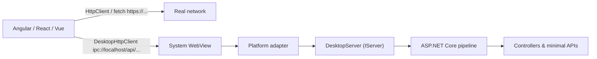

# AspNetDesktop

[](https://github.com/armanossiloko/aspnet-desktop/actions/workflows/ci.yml)
[](https://github.com/armanossiloko/aspnet-desktop/releases)
[](https://www.nuget.org/packages/AspNetDesktop)
[](https://www.npmjs.com/package/aspnetdesktop-client)
[](https://github.com/armanossiloko/aspnet-desktop/blob/master/LICENSE)

Build desktop apps with an **ASP.NET Core backend** and **any JavaScript UI** (Angular, React, Vue, ...), Tauri-style — but with .NET instead of Rust, and with real MVC instead of `invoke('command')`.

The full ASP.NET Core pipeline (controllers, minimal APIs, model binding, filters, auth, ProblemDetails, JSON) runs **in-process with no Kestrel and no TCP port**. The system WebView talks to it over two custom schemes:

| Scheme | Purpose | Who uses it |
|---|---|---|
| `app://localhost` | UI origin: static files + SPA fallback | The WebView loads the app from here |
| `ipc://localhost` | API origin: your controllers / minimal APIs | Only `DesktopHttpClient` |

Nothing on the machine can reach your API: there is no socket to connect to.



## Get started

### Prerequisites

- [.NET 10 SDK](https://dotnet.microsoft.com/download/dotnet/10.0) and [Node.js](https://nodejs.org/) 22 or later.
- The system WebView for your OS (see [docs/platforms.md](https://github.com/armanossiloko/aspnet-desktop/blob/master/docs/platforms.md)):
  - **Windows**: the WebView2 Runtime, already installed on Windows 11 and current Windows 10.
  - **macOS** 14+: `dotnet workload install macos` and the Xcode version that workload asks for.
  - **Linux**: GTK 4 and WebKitGTK 6, e.g. `sudo apt install libgtk-4-1 libwebkitgtk-6.0-4` on Ubuntu 24.04+.

### Create an app

The templates (Angular, React or Vue) come with the build wiring and hot reload set up:

```bash
dotnet new install AspNetDesktop.Templates
dotnet new aspnetdesktop-vue -o MyApp          # or: aspnetdesktop-angular, aspnetdesktop-react
cd MyApp
dotnet run -c Release                           # builds the UI into wwwroot and opens the window
```

For hot reload while you work, run the dev server and the app side by side:

```bash
cd ClientApp && npm install && npm start        # Vite on :5173 (Angular: ng serve on :4200)
dotnet run                                      # from MyApp, in a second terminal: the window loads the dev server
```

### Add to an existing project

```bash
dotnet add package AspNetDesktop
npm install aspnetdesktop-client                # in your frontend
```

```csharp
var builder = WebApplication.CreateBuilder(args);
builder.AddDesktopHost();          // replaces Kestrel; no TCP bind
builder.Services.AddControllers();

var app = builder.Build();
app.UseStaticFiles();              // Angular/React/Vue dist served from app://
app.MapControllers();              // real MVC / minimal APIs on ipc://
app.MapFallbackToFile("index.html");
app.RunDesktop();                  // opens the window; returns when it closes
```

The target framework selects the adapter: `net10.0-windows` uses WebView2, `net10.0-macos` uses WKWebView, and `net10.0` on Linux uses WebKitGTK 6 ([platform notes](https://github.com/armanossiloko/aspnet-desktop/blob/master/docs/platforms.md)). The templates pick it per OS like this:

```xml
<TargetFramework Condition="$([MSBuild]::IsOSPlatform('Windows'))">net10.0-windows</TargetFramework>
<TargetFramework Condition="$([MSBuild]::IsOSPlatform('OSX'))">net10.0-macos</TargetFramework>
<TargetFramework Condition="'$(TargetFramework)' == ''">net10.0</TargetFramework>
```

## Two clients: real HTTP vs the in-process API

The framework never patches `fetch` or Angular's `HttpClient`. Real HTTP stays real; the desktop API gets its own client from [`aspnetdesktop-client`](https://github.com/armanossiloko/aspnet-desktop/tree/master/src/client).

**Angular**

```ts
// app.config.ts
providers: [provideHttpClient(), provideDesktopHttpClient()]

// component
private http = inject(HttpClient);            // https://... over the network
private desktop = inject(DesktopHttpClient);  // ipc://localhost, in-process

this.http.get<Weather>('https://api.weather.example/forecast');
this.desktop.get<Metadata>('/api/metadata');
this.desktop.post<Order>('/api/orders', body);
```

`DesktopHttpClient` *is* an `HttpClient` (same `get/post/put/patch/delete`, generics, `params`, `observe`, `HttpErrorResponse`), constructed with its own backend. Your app's interceptors don't run on it; pass `provideDesktopHttpClient({ interceptors: [...] })` for desktop-only ones.

**React**

```tsx
// main.tsx
import { DesktopHttpProvider } from 'aspnetdesktop-client/react';

createRoot(root).render(<DesktopHttpProvider><App /></DesktopHttpProvider>);

// component
const desktop = useDesktopHttpClient();      // ipc://localhost, in-process
const metadata = await desktop.get<Metadata>('/api/metadata');
await fetch('https://api.weather.example/forecast');   // real HTTP, untouched
```

**Vue**

```ts
// main.ts
import { createDesktopHttp } from 'aspnetdesktop-client/vue';

createApp(App).use(createDesktopHttp()).mount('#app');

// <script setup>
const desktop = useDesktopHttpClient();      // or this.$desktop in the Options API
const metadata = await desktop.get<Metadata>('/api/metadata');
```

**Svelte, Solid, vanilla, ...**

```ts
import { createDesktopHttpClient, DesktopHttpError } from 'aspnetdesktop-client';

const desktop = createDesktopHttpClient();
try {
  await desktop.post<Order>('/api/orders', { product: 'Tea', quantity: 1 });
} catch (e) {
  if (e instanceof DesktopHttpError && e.status === 400) showErrors(e.error); // ValidationProblemDetails
}
```

The React, Vue and vanilla clients share one promise-based API (`get/post/put/patch/delete/request`, `DesktopHttpError`), so they work directly as a TanStack Query or SWR fetcher. The provider and the plugin also take a `client` option, so you can swap in a fake in tests.

All clients resolve against `window.__ASPNETDESKTOP__.ipcBase` (injected by the host) and refuse absolute URLs that aren't on `ipc://`, so real HTTP can't be sent through them by mistake.

## How it works

- **`DesktopServer`** (`AspNetDesktop.Hosting`) implements `IServer`. `StartAsync` binds nothing; it keeps the `IHttpApplication<TContext>`. Each request gets its own `IFeatureCollection` (request, buffered response with `OnStarting`/`OnCompleted`, body, lifetime, identifier) and runs through the normal pipeline. Everything above `IServer` works unchanged.
- **Adapters** turn native WebView requests into `DesktopHttpRequest` and call one method:
  ```csharp
  Task<DesktopHttpResponse> ProcessAsync(DesktopHttpRequest request, CancellationToken ct);
  ```
  - Windows registers `app`/`ipc` with `CoreWebView2CustomSchemeRegistration` *before* the WebView2 environment is created (the piece that makes `fetch('ipc://...')` work) and answers `WebResourceRequested` with a deferral, so ASP.NET Core runs on the thread pool, not the UI thread.
  - macOS uses `WKURLSchemeHandler` for both schemes (method, headers, `HTTPBody`/`HTTPBodyStream`).
  - Linux uses `WebContext.RegisterUriScheme` (`GetHttpMethod`/`GetHttpHeaders`/`GetHttpBody`/`FinishWithResponse`) and marks both schemes secure and CORS-enabled.
- **Scheme-aware routing**: endpoints answer on `ipc://` only; `MapFallback*` endpoints answer on `app://` only. A relative `fetch('/api/x')` from the UI lands on `index.html`, never on a controller, and an unknown `ipc://localhost/api/...` route is a real 404 rather than `index.html`. Override per endpoint with `.RequireDesktopScheme(DesktopScheme.App | DesktopScheme.Ipc)` or `[RequireDesktopScheme(...)]` (useful for `MapStaticAssets()`).
- **`CreateClient()`**: the .NET sibling of `DesktopHttpClient`, for tests or in-process callers. It goes through the same security policy:
  ```csharp
  await app.StartAsync();
  using HttpClient client = app.CreateDesktopClient();   // BaseAddress = ipc://localhost/
  var metadata = await client.GetFromJsonAsync<Metadata>("/api/metadata");
  ```

## Security model

- No loopback socket. `ASPNETCORE_URLS`, `UseUrls()` and launch-profile URLs are ignored; nothing is bound.
- `ipc://` checks `Origin` against an allow-list: `app://localhost` plus `Desktop:AllowedOrigins`, plus `Desktop:DevServerUrl` **in Development only**. Other origins get a 403 without CORS headers.
- CORS headers are emitted by the host for allow-listed origins only (never `*`); preflights are answered before the pipeline.
- `app://` only accepts `GET`/`HEAD`.
- Top-level navigation is restricted to `app://localhost` (and the dev server in Development). `http(s)`/`mailto`/`tel` links open in the system browser; everything else (`file:`, `ipc:`, `javascript:`, ...) is blocked. `target=_blank` never opens a second window.
- Optional defense in depth: `RequireRequestToken = true` generates a per-process token, exposes it only to UI-origin documents as `__ASPNETDESKTOP__.token`, and rejects `ipc://` requests without it. Both clients send it automatically.

## Configuration

Bound from the `Desktop` section of configuration, then from `AddDesktopHost(options => ...)`:

```json
{
  "Desktop": {
    "Title": "My App",
    "Width": 1280,
    "Height": 800,
    "Maximized": false,
    "StartPath": "/",
    "DevServerUrl": "http://localhost:4200",
    "AllowedOrigins": [],
    "AllowRequestsWithoutOrigin": true,
    "RequireRequestToken": false,
    "EnableDevTools": null,
    "UserDataFolder": null
  }
}
```

`DevServerUrl` only applies when the environment is `Development` (put it in `appsettings.Development.json`). `EnableDevTools` defaults to Development only. The WebView profile defaults to `<LocalApplicationData>/<ApplicationName>/WebView`.

If your app is started from another working directory, `AddDesktopHost()` falls back to the `wwwroot` next to the executable. The samples also set `ContentRootPath = AppContext.BaseDirectory` so `appsettings.json` resolves the same way.

## Packages

| Package | |
|---|---|
| [`AspNetDesktop`](https://www.nuget.org/packages/AspNetDesktop) | Metapackage: Hosting + the adapter for your target framework, and `app.RunDesktop()` |
| [`AspNetDesktop.Hosting`](https://www.nuget.org/packages/AspNetDesktop.Hosting) | `DesktopServer`, options, isolation policy, `AddDesktopHost()`, `CreateClient()`; no UI dependencies |
| [`AspNetDesktop.Windows`](https://www.nuget.org/packages/AspNetDesktop.Windows) / [`.Mac`](https://www.nuget.org/packages/AspNetDesktop.Mac) / [`.Linux`](https://www.nuget.org/packages/AspNetDesktop.Linux) | Platform adapters |
| [`AspNetDesktop.Templates`](https://www.nuget.org/packages/AspNetDesktop.Templates) | `dotnet new aspnetdesktop-angular`, `aspnetdesktop-react` and `aspnetdesktop-vue` |
| [`aspnetdesktop-client`](https://www.npmjs.com/package/aspnetdesktop-client) (npm) | `DesktopHttpClient` for Angular, a provider and hook for React, a plugin and composable for Vue, and `createDesktopHttpClient()` for everything else |

Every release is also on [GitHub Packages](https://github.com/armanossiloko?tab=packages&repo_name=aspnet-desktop), where the client is scoped as `@armanossiloko/aspnetdesktop-client`.

## Limitations

- No WebSockets or SignalR: custom schemes don't upgrade to `ws:`. A postMessage transport could come later.
- No streaming responses: responses are buffered before they're handed to the WebView.
- One window per app, and no native dialogs, installers or auto-update yet.

## Contributing

Issues and pull requests are welcome. [CONTRIBUTING.md](https://github.com/armanossiloko/aspnet-desktop/blob/master/CONTRIBUTING.md) covers building from source, the samples and the tests; report security issues privately as described in [SECURITY.md](https://github.com/armanossiloko/aspnet-desktop/blob/master/SECURITY.md). Release notes are on the [releases page](https://github.com/armanossiloko/aspnet-desktop/releases) and in the changelogs for the [NuGet packages](https://github.com/armanossiloko/aspnet-desktop/blob/master/CHANGELOG.md) and the [npm client](https://github.com/armanossiloko/aspnet-desktop/blob/master/src/client/CHANGELOG.md).

## License

[MIT](https://github.com/armanossiloko/aspnet-desktop/blob/master/LICENSE), copyright Arman Ossi Loko.

Apps created from the templates credit the project in their footer:

> Built with [AspNetDesktop](https://github.com/armanossiloko/aspnet-desktop) by Arman Ossi Loko

Keeping it is appreciated but not required.
