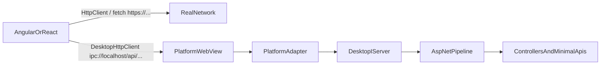

> **Design document.** This is the original plan AspNetDesktop was built from, kept for context. Where the implementation differs, the code and the [README](../README.md) win. Notable differences: the npm package is `aspnetdesktop-client` (not `@aspnetdesktop/client`), and `dotnet new` templates ship as `AspNetDesktop.Templates`.

# AspNetDesktop: isolated ASP.NET + JS desktop host

Build a new .NET 10 library that hosts a full ASP.NET Core MVC/minimal-API pipeline in-process, with no Kestrel TCP port. The SPA keeps the standard `HttpClient` / `fetch` for real HTTP, and uses a dedicated `DesktopHttpClient` for isolated in-process API calls over `ipc://`.

The framework lives in this repository. The idea it grew out of is [armanossiloko/avalonia-angular-desktop](https://github.com/armanossiloko/avalonia-angular-desktop) (Avalonia + Angular + an ASP.NET Core API on localhost).

## Original backstory

Build an extension to the .NET framework (.NET 10 and onwards) where one can build desktop apps using ASP.NET Core as a backend while writing the UI in a JS framework of their choice like Angular or React. Once the desktop app runs, the UI comes from, for example, an Angular app and it can access the desktop backend (.NET) logic using something like an HTTP protocol — but unlike this repo, the desktop app should not run an actual ASP.NET Core API on localhost. It should all be isolated.

Tauri JS has something like its own `ipc://` protocol. The backend should still function like a proper MVC API.

## Why not evolve this repo

That repo is the right *product idea* (Avalonia window + Angular + ASP.NET) and the wrong *transport*. Today it starts Kestrel on `http://localhost:54321` and the Angular app hardcodes that URL in the **standard** `HttpClient` ([`WebApplicationCreator.cs`](https://github.com/armanossiloko/avalonia-angular-desktop/blob/master/src-dotnet/DesktopApp/WebApplicationCreator.cs), [`app.ts`](https://github.com/armanossiloko/avalonia-angular-desktop/blob/master/src/app/app.ts)). Anything on the machine can call that API, and real HTTP is mixed with desktop calls.

It also cannot be patched into an isolated host:

- `WebView.Avalonia` (what this example uses) has no request-response hook.
- Official Avalonia `NativeWebView` fires `WebResourceRequested` but **cannot supply a response** ([Avalonia.Controls.WebView#53](https://github.com/AvaloniaUI/Avalonia.Controls.WebView/issues/53)).
- Photino.NET’s custom-scheme handler only returns a `Stream` + content-type (no method, headers, body, or status). `fetch()` to custom schemes is still broken on stock Photino ([photino.NET#232](https://github.com/tryphotino/photino.NET/issues/232)).

This is a community hosting extension for ASP.NET Core, not a patch to the official .NET runtime. The public API should still feel like a first-class host: `builder.AddDesktopHost()` / `app.RunDesktop()`.

## Two clients: real HTTP vs isolated API

The .NET side stays a **real ASP.NET Core API** (controllers, minimal APIs, model binding, status codes, JSON). The frontend does **not** hijack the browser `HttpClient` / `fetch` for that.

| Client | Used for | Transport |
|---|---|---|
| Standard `HttpClient` / `fetch` | Real HTTP — public APIs, downloads, anything on `http:`/`https:` | Normal network stack. The framework never intercepts or rewrites it. |
| `DesktopHttpClient` | Isolated calls to the in-process .NET API | Custom scheme `ipc://localhost` handled only by the embedded WebView |

Angular usage:

```ts
constructor(
  private http: HttpClient,
  private desktop: DesktopHttpClient,
) {}

// Real HTTP — untouched
this.http.get<Weather>('https://api.weather.example/forecast');

// In-process MVC — isolated, HTTP-shaped
this.desktop.get<Metadata>('/api/metadata');
this.desktop.post<Order>('/api/orders', body);
```

`DesktopHttpClient` mirrors the familiar surface (`get` / `post` / `put` / `patch` / `delete` + generics + headers/query). It is a **separate class**, not an interceptor on `HttpClient`. In Angular it can be a second `HttpClient` constructed with a custom `HttpBackend`; in React/vanilla it is a small `fetch`-like helper. Both always target `ipc://localhost`.

This keeps “APIs” as the product: authors still write `[ApiController]` / `MapGet`, and the dedicated client is just the isolated HTTP transport to those endpoints.



UI assets use a second scheme (`app://localhost`) so a relative `this.http.get('/api/...')` cannot silently hit the desktop pipeline. Only `DesktopHttpClient` talks to `ipc://`.

## Target host experience

```csharp
var builder = WebApplication.CreateBuilder(args);
builder.AddDesktopHost();          // replaces Kestrel; no TCP bind
builder.Services.AddControllers();

var app = builder.Build();
app.UseStaticFiles();              // Angular/React dist served from app://
app.MapControllers();              // real MVC / minimal APIs on ipc://
app.MapFallbackToFile("index.html");
app.RunDesktop();
```

Isolation: the pipeline never listens on a socket. The only caller of MVC is the embedded WebView, via `ipc://`.

## Protocol

Two authority-bearing custom schemes on every OS:

- `app://localhost/` — UI origin (static files, SPA fallback). Secure context.
- `ipc://localhost/` — API origin. Secure context. Only `DesktopHttpClient` uses it.

Both are registered with `TreatAsSecure` + `HasAuthorityComponent`. `ipc://` `AllowedOrigins` is an allow-list: `app://localhost` plus explicit dev servers (`http://localhost:4200`, `http://localhost:5173`).

The adapter routes by scheme:

- `app://` → static files / SPA (same `IServer`, but only the file pipeline is intended here)
- `ipc://` → full ASP.NET API pipeline (MVC, minimal APIs, auth, etc.)

This is Tauri-like isolation (`ipc://`) while keeping HTTP verbs, paths, status codes, and bodies instead of `invoke('command')`.

**Debug / HMR** (ng serve or Vite):

- WebView loads `http://localhost:4200` or `:5173`
- `HttpClient` still does real HTTP (including the dev server’s own assets)
- `DesktopHttpClient` still calls `ipc://localhost/api/...`
- Host injects `window.__ASPNETDESKTOP__ = { ipcBase: 'ipc://localhost' }` so the client does not hardcode anything

**Out of v1:** WebSockets / SignalR. Custom schemes do not upgrade to `ws:`. A postMessage SignalR transport can come later.

## Core: production `IServer` (not Kestrel, not TestServer)

Implement `Microsoft.AspNetCore.Hosting.Server.IServer` ourselves. `Microsoft.AspNetCore.TestHost.TestServer` is the in-memory precedent, but it is a test package. A public framework should own:

- Per-request `IFeatureCollection` with `IHttpRequestFeature`, `IHttpResponseFeature`, `IHttpResponseBodyFeature`, `IHttpRequestLifetimeFeature`
- `StartAsync` that **does not bind a port**; it only keeps `IHttpApplication<TContext>` so adapters can call `ProcessRequestAsync`
- `IServerAddressesFeature` advertising `app://localhost/` and `ipc://localhost/`
- `CreateClient()` for unit/integration tests (same idea as TestServer; this is the .NET-side sibling of `DesktopHttpClient`)

`builder.AddDesktopHost()` registers this `IServer` instead of Kestrel.

Adapters convert native webview requests into those features (method, path, query, headers, body stream) and copy status/headers/body back. Use `GetDeferral()` on WebView2 so ASP.NET stays async and the UI thread is not blocked.

MVC, model binding, filters, auth middleware, `IActionResult`, and JSON all work unchanged because they sit above `IServer`.

## Platform adapters (designed together; required for v1)

Do **not** depend on Avalonia or Photino for the HTTP path. Each adapter owns a window + system webview and talks to the same `IServer`.

- Windows: WinForms chrome + WebView2; register `app` and `ipc` via `CoreWebView2CustomSchemeRegistration` + `WebResourceRequested`
- macOS: `net10.0-macos` NSWindow + WKWebView `IWKUrlSchemeHandler` for both schemes
- Linux: GTK4 + WebKitGTK 6 via GirCore; `WebContext.RegisterUriScheme` for both schemes (`GetHttpMethod` / `GetHttpHeaders` / `GetHttpBody` / `FinishWithResponse`)

Windows needs both schemes registered **before** `CoreWebView2Environment` is created. That is the piece Photino is missing and why `fetch('app://...')` fails there.

Shared adapter contract (in Hosting):

```csharp
Task<DesktopHttpResponse> ProcessAsync(DesktopHttpRequest request, CancellationToken ct);
```

Navigation policy: stay on `app://` (and configured dev origins). External `https://` links from the standard `HttpClient` or `<a href>` are real network; top-level navigations off the UI origin open in the system browser.

## Frontend package (`@aspnetdesktop/client`)

First-class, not a sample-only snippet:

- `DesktopHttpClient` with HttpClient-like methods and JSON generics
- Angular: `provideDesktopHttpClient()` — separate from `provideHttpClient()`
- React/vanilla: `createDesktopHttpClient()` returning promises
- Always resolves against `ipc://localhost` (or injected `ipcBase`)
- Maps HTTP status to thrown errors the same way apps already handle `HttpClient` failures
- Does not wrap or replace global `fetch` / Angular `HttpClient`

## Repo layout

```
aspnet-desktop/
  src\
    AspNetDesktop.Hosting\          # IServer, options, AddDesktopHost, CreateClient
    AspNetDesktop.Windows\          # net10.0-windows, WebView2
    AspNetDesktop.Mac\              # net10.0-macos, WKWebView
    AspNetDesktop.Linux\            # net10.0, GirCore.Gtk-4.0 + GirCore.WebKit-6.0
    AspNetDesktop\                  # metapackage + RunDesktop() that picks the RID
  src\client\                       # @aspnetdesktop/client (DesktopHttpClient)
  samples\
    AngularApp\                     # HttpClient + DesktopHttpClient + MVC
    ReactApp\
  tests\
    AspNetDesktop.Hosting.Tests\    # pipeline tests with CreateClient, no WebView
  templates\                        # later: dotnet new desktop-angular / desktop-react
```

Target `net10.0` (and OS TFMs where required). FrameworkReference `Microsoft.AspNetCore.App`.

## Sample apps (what people copy)

- .NET: `MapGet("api/metadata", ...)` or a `[ApiController]` — a normal API
- Angular/React: `this.http` for any real HTTP demo; `this.desktop.get<Metadata>('/api/metadata')` for the backend
- `wwwroot` filled by `npm run build` in Release, served from `app://`
- Debug: desktop process + `ng serve` / Vite; `DesktopHttpClient` still uses `ipc://`

MSBuild in samples: Release target runs the JS build and copies `dist` into `wwwroot`.

## Security baseline

- No loopback socket
- `ipc://` `AllowedOrigins` is an allow-list (`app://localhost` + explicit dev servers)
- Standard `HttpClient` is never pointed at `ipc://` by the framework
- Block top-level navigation off `app://` except allow-listed dev URLs
- Optional runtime request token (Tauri-style invoke key) as defense in depth if the WebView is ever pointed at untrusted HTML — not required for the first sample
- No `AllowAnyOrigin` CORS on the isolated pipeline; CORS only for listed dev origins calling `ipc://`

## Implementation order

The hosting `IServer` is written and tested first so MVC behavior is proven without a WebView. Platform adapters then become thin translators. Windows + Angular + `DesktopHttpClient` should be runnable first; Linux/macOS adapters follow immediately against the same contract.

v1 explicitly does **not** include installers, auto-update, multi-window, native file dialogs, or SignalR.

### Work items

- [ ] Scaffold `aspnet-desktop` and implement Desktop `IServer` + `AddDesktopHost` + `CreateClient` with Hosting tests (GET/POST, headers, JSON, static files, MVC)
- [ ] Implement Windows WebView2 adapter: register `app://` and `ipc://`, `WebResourceRequested` deferral, `RunDesktop` message loop
- [ ] Implement Linux GTK4 + WebKitGTK adapter via GirCore with full HTTP method/headers/body mapping for both schemes
- [ ] Implement macOS WKWebView adapter via `IWKUrlSchemeHandler` for `app://` and `ipc://`
- [ ] Ship `@aspnetdesktop/client` with `DesktopHttpClient` (Angular + vanilla/React) that mirrors HttpClient `get`/`post`/`put`/`patch`/`delete` generics and always targets `ipc://`
- [ ] Add Angular and React samples that use `HttpClient` for real HTTP and `DesktopHttpClient` for in-process MVC APIs, plus debug HMR

## What we are not doing

- Binding Kestrel, HTTP.sys, or named pipes “just for the WebView”
- Using Photino or Avalonia WebView as the IPC transport
- Replacing or intercepting the standard `HttpClient` / `fetch`
- Inventing a JS `invoke('command')` RPC as the primary API (the dedicated client is still HTTP to real MVC endpoints)
- Changing the original example repo except optionally adding a README pointer to the new framework later
